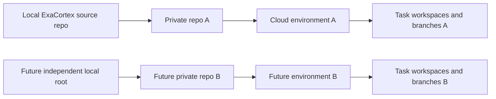

# Два независимых проекта Codex

Подготовлена только схема. Второй продукт, его функциональность, папки, repository или environment в этом спринте не создавались.

| Ресурс | ExaCortex | Будущий проект B |
|---|---|---|
| Рабочая папка | ExaCortex_Cloud_Ready_RC3 | отдельный PROJECT_B_ROOT, не дочерняя папка ExaCortex |
| Git repository | собственный PRIVATE repo A | другой PRIVATE repo B |
| Cloud Environment | ExaCortex-dev, только repo A | отдельная среда B, только repo B |
| Ветки | feature/A-task-id | feature/B-task-id в repo B |
| БД/fixtures | свои temporary/.test-data | свои temporary/.test-data |
| Тесты/отчёты | scripts/cloud_checks.py, test_artifacts A | собственные команды и reports B; функциональность пока не определена |
| AGENTS/config | только правила A | отдельные правила B |
| Порты при локальной работе | например8765 | другой свободный порт, например8766 |

Между A/B нет общей рабочей БД, branch, secrets, папки экспортов или тестового каталога. Не подключать оба repo к одной среде ради удобства. Разрешения GitHub ограничивать выбранным repo, а не всеми репозиториями. Не использовать общий глобальный EXACORTEX_LEARNING_DIR: задавать data directory для каждого процесса, иначе приложения могут открыть одну библиотеку несмотря на разные repo.

## Параллельность внутри одного проекта

Одна задача — одна ветка и отдельный worktree/Cloud task workspace. У двух исполнителей не должно быть одной рабочей папки. Перед началом назначить владельцев файлов; если обе задачи затрагивают общий модуль, интегратор планирует последовательное объединение. Независимые frontend/backend PR допустимы только с зафиксированными интерфейсами и общей интеграционной проверкой.

PR содержит проблему/результат, список изменений, реальные test results, ограничения, миграции и rollback. Интегратор сначала принимает базовый PR, обновляет вторую ветку и повторяет тесты; конфликты не разрешаются простым копированием целых файлов поверх. Никаких force push, reset/clean или автоматической замены стабильного релиза.

## Независимые бюджеты и приёмка

Каждый проект ведёт отдельный статус, отчёты и список NOT TESTED. Не считать PASS проекта A доказательством готовности B. Облачный доступ обоих проектов разрешается отдельно; included allowance аккаунта может быть общим, поэтому параллельность не означает удвоение бесплатного лимита. При достижении лимитов остановить удалённые задачи, не покупать credits и продолжить локальные проверки.

Из Cloud возвращаются commits/PR и код, а не личные SQLite/медиа. Для приёмки A создавать новый локальный integration checkout и синтетическую БД; для B — свой checkout. Только после независимой приёмки готовить новые releases; production A/B не изменяется задачами разработки.
